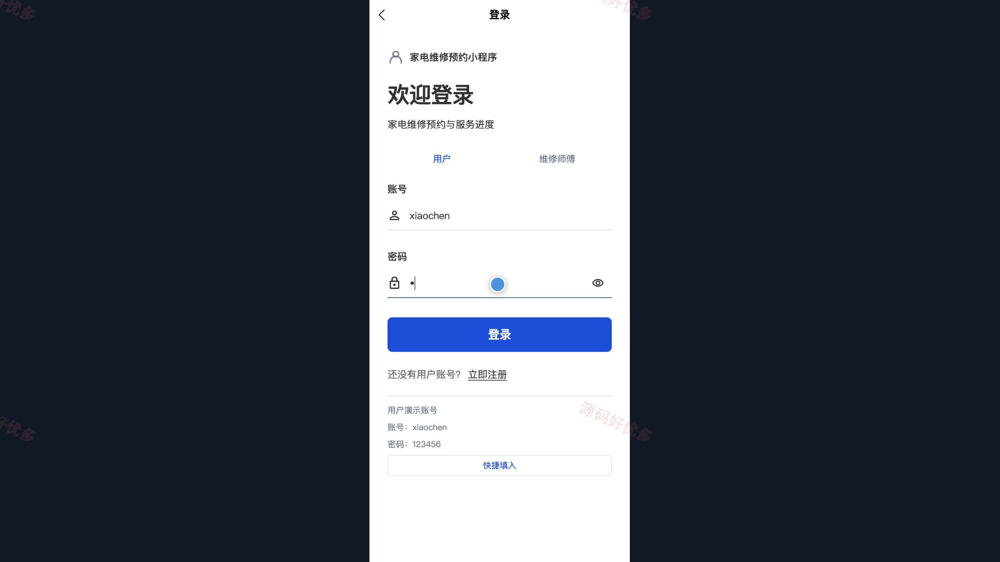
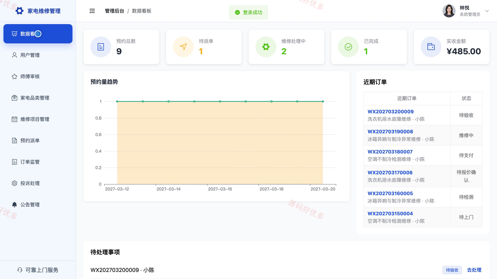
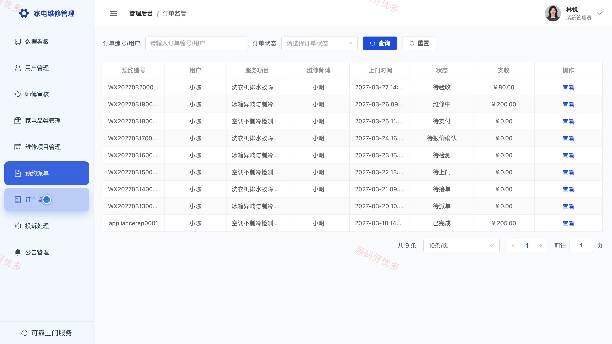

# bs133B
bs133B家电维修预约小程序源码 Java SpringBoot3 Vue3 前后分离
## 源码问题查看主页咨询

### 一、关键词
家电维修预约、上门维修、维修派单、家电报修、售后服务

### 二、作品包含
源码+数据库+万字设计文档+PPT+全套环境和工具资源+本地部署教程

### 三、项目技术
前端技术： Html、Css、Js、Vue3.4、Element-Plus、uniapp
后端技术：Java、SpringBoot3.2.0、MyBatis-Plus

### 四、运行环境要求
开发工具：IDEA/eclipse + VSCODE + HBuilder X + 微信开发者工具

数据库：MySQL5.7+（共7张表）

数据库管理工具：Navicat10以上版本

环境配置软件： JDK17 + Maven3.6

前端Nodejs：20

浏览器：谷歌浏览器

### 五、项目介绍
项目编号：bs133B

面向家电报修与上门维修场景，用户通过小程序浏览服务并预约上门，维修师傅处理派单、检测报价和完工记录，管理员在电脑端维护服务项目、审核师傅并管理订单与投诉。

角色：用户、维修师傅、管理员

用户功能：账号注册与登录、浏览维修服务与公告、提交上门预约、查看预约进度与详情、确认维修报价并模拟支付、确认完工、评价与投诉、维护个人资料。

维修师傅功能：账号登录、查看维修工作台和派单、接受或拒绝派单、记录检测结果与维修报价、更新维修进度、登记配件与完工说明、查看服务记录和公告。

管理员功能：查看数据看板、管理用户与审核师傅、管理家电品类与维修项目、预约派单、监管维修订单、处理用户投诉、管理服务公告。

### 六、运行截图

